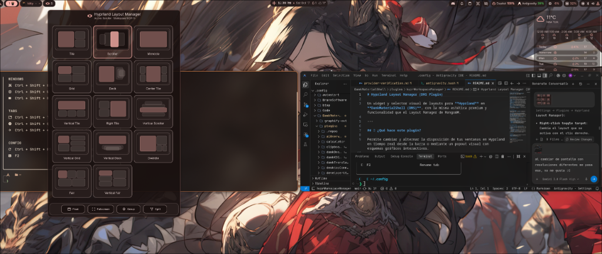
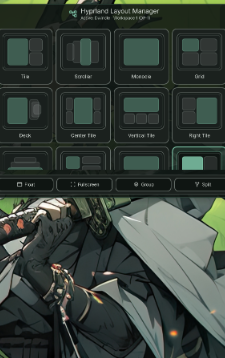

# Hyprland Layout Manager (DMS Plugin)

[](https://hyprland.org)
[](https://github.com/AvengeMedia/DankMaterialShell)
[](https://opensource.org/licenses/MIT)
[](plugin.json)

A visual layout switcher, cycle rotator, and window management plugin for **Hyprland** in **DankMaterialShell (DMS)**, bringing the versatile layout workflow of MangoWM into Hyprland with native Material Design aesthetics.



---

## 🎯 Features

- **Visual Layout Popout**: Interactive popout grid showing live wireframe schematics of all 14 layout arrangements.
- **DankBar Status Pill**: Displays the active layout icon and mnemonic code (e.g., `DW`, `T`, `CT`, `M`, `S`) directly in your bar.
- **Effortless Mouse Controls**:
  - **Left-Click**: Opens the visual layout selector popout.
  - **Right-Click**: Instantly toggles between your current layout and your preferred target (default: `Monocle` / Fullscreen).
  - **Middle-Click**: Instantly toggles a secondary layout (default: `Center Tile`).
  - **Scroll Wheel**: Cycles smoothly through your enabled layout rotation list.
- **Quick Action Dock**: Direct toggles for **Float**, **Fullscreen**, **Tabbed Group (Deck)**, and **Dwindle Split Direction** inside the popout.
- **Responsive Multi-Monitor Design**: Automatically calculates proportional dimensions (3-column layout on standard screens, 4-column layout on ultrawide monitors) per display.
- **Configurable Rotation & Settings**: Customize rotation order, hide unused layouts, set cooldown speeds, and configure quick-toggle targets from the DMS Settings UI.

---

## 📸 Interface Showcase

### Layout Selector Popout
Displays interactive preview cards for each layout mode. The active layout is highlighted with the current DMS accent color.



---

## 📐 Supported Layout Modes

| Code | Name | Description |
| :---: | :--- | :--- |
| **`T`** | **Tile** | Master window on the left, stack columns on the right. |
| **`RT`** | **Right Tile** | Master window on the right, stack columns on the left. |
| **`VT`** | **Vertical Tile** | Master window on top, secondary windows stacked horizontally below. |
| **`CT`** | **Center Tile** | Large master window centered, flanked by left and right stack columns. |
| **`DW`** | **Dwindle** | Classic Hyprland binary-tree spiral layout. |
| **`M`** | **Monocle** | Fullscreen / single focused window mode. |
| **`K`** | **Deck (Group)** | Windows grouped into tabs (tabbed deck). |
| **`G`** | **Grid** | Balanced grid layout with pseudo-tiling. |
| **`F`** | **Fair** | Even horizontal window distribution. |
| **`VF`** | **Vertical Fair** | Even vertical window distribution (stacked master). |
| **`S`** | **Scroller** | Horizontal window carousel / infinite scrolling column layout. |
| **`VS`** | **Vertical Scroller** | Vertical carousel scrolling layout. |
| **`VG`** | **Vertical Grid** | Vertical-oriented grid matrix. |
| **`VK`** | **Vertical Deck** | Vertical tabbed deck representation. |

---

## 🚀 How to Use

### From the DankBar Pill
- **Left-Click**: Toggle the layout chooser popout.
- **Right-Click**: Toggle your primary target layout (defaults to **Monocle**). Clicking again restores the previous layout.
- **Middle-Click (Scroll Button)**: Toggle your secondary target layout (defaults to **Center Tile**).
- **Mouse Wheel / Trackpad Scroll**: Cycle forward or backward through your active layout rotation list.

### From the Layout Popout
1. Click on any layout card to immediately re-arrange windows on the current workspace.
2. Use the **Quick Actions** bar at the bottom:
   - **Float**: Toggle active window between tiling and floating mode.
   - **Fullscreen**: Toggle fullscreen mode on the active window.
   - **Group**: Group active window into a tabbed group or toggle group lock.
   - **Split**: Toggle split orientation in Dwindle mode.

---

## ⚙️ Configuration (DMS Settings)

Navigate to **DMS Settings → Plugins → Hyprland Layout Manager**:

1. **Right-click toggle target**: Select which layout activates when right-clicking the bar pill (e.g., `Monocle`, `Dwindle`, `Center Tile`, or `None`).
2. **Middle-click toggle target**: Select which layout activates when clicking the scroll wheel.
3. **Scroll cycle list**:
   - Click the **Eye icon** to show or hide individual layouts in the rotation list and popout.
   - Use the **Drag handle** to change the order in which layouts cycle.
4. **Scroll speed**: Minimum cooldown in milliseconds between scroll steps (prevents rapid over-scrolling on sensitive trackpads).

---

## 🔧 Requirements

- **Hyprland** (tested on 0.50.x through 0.56.2+; fully supports both modern Lua configurations `hyprland.lua` and classic `hyprland.conf` syntax).
- **DankMaterialShell (DMS)** v1.2.0 or higher.
- **Python 3** (used by the lightweight layout helper script `hypr_layout.py`).

---

## 📦 Installation & Setup

1. Clone or copy the repository into your DMS plugins directory:
   ```bash
   git clone https://github.com/WilliamAWSOFTWARE/dms-hypr-workspace-manager.git ~/.config/DankMaterialShell/plugins/hyprWorkspaceManager
   ```

2. Open **DMS Settings** (`SUPER + N` or via Control Center) → **Plugins** and verify **Hyprland Layout Manager** is enabled.

3. Add the widget to your bar configuration in **DMS Settings → Bar Settings → Right Widgets**, or verify `"hyprWorkspaceManager"` is listed under `rightWidgets` in `~/.config/DankMaterialShell/settings.json`.

4. Reload DMS:
   ```bash
   dms restart
   ```

---

## 💙 Acknowledgments & Credits

- Inspired by and adapted from [DMSMangoWMLayoutManager](https://github.com/omarluq/DMSMangoWMLayoutManager) by **Omar Alani** (licensed under MIT).
- Re-architected and completely engineered with a custom `hyprctl` daemon engine (`hypr_layout.py`) to bring the dynamic layout switching workflow natively to **Hyprland**.

---

## 📄 License

This project is licensed under the [MIT License](LICENSE).
Created with ❤️ for the Linux & Hyprland community by [WilliamAWSOFTWARE](https://github.com/WilliamAWSOFTWARE).
