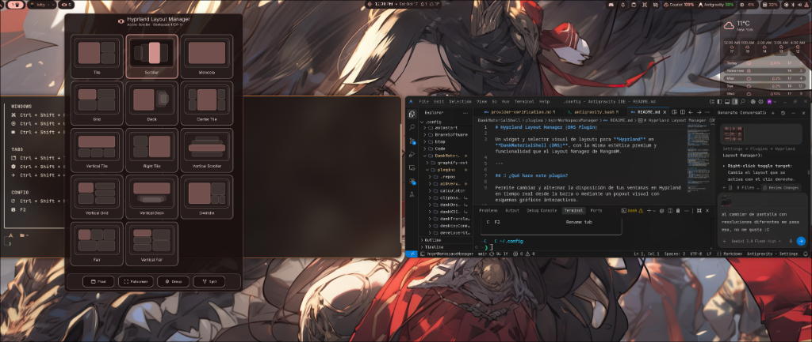
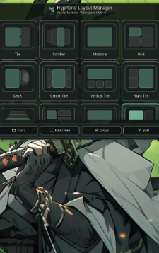

# Hyprland Layout Manager (DMS Plugin)

[](https://hyprland.org)
[](https://github.com/AvengeMedia/DankMaterialShell)
[](https://opensource.org/licenses/MIT)
[](plugin.json)

A visual layout switcher, cycle rotator, and window management plugin for **Hyprland** in **DankMaterialShell (DMS)**, bringing the versatile layout workflow of MangoWM into Hyprland with native Material Design aesthetics.

> [!NOTE]
> **Plugin ID & Repository Name**: This plugin is identified as `hyprWorkspaceManager` (repository: `dms-hypr-workspace-manager`). Originally conceived as a workspace switcher, from v1.2.0 onwards it evolved into a dedicated **Hyprland Layout Manager** to deliver robust dynamic layout rotation, wireframe previews, and focused window state management.



---

## 🎯 Features

- **Visual Layout Popout**: Interactive popout grid showing live wireframe schematics of 8 native Hyprland layout arrangements.
- **Smooth Popout Scrolling**: Integrated custom scrollbar and mouse-wheel support (`WheelHandler`) ensuring all cards and controls are accessible on any screen resolution.
- **DankBar Status Pill**: Displays the active layout icon and mnemonic code (e.g., `DW`, `T`, `CT`, `M`, `RT`) directly in your bar.
- **Effortless Mouse Controls**:
  - **Left-Click**: Opens the visual layout selector popout.
  - **Right-Click**: Instantly toggles between your current layout and your preferred target (default: `Monocle` / Fullscreen).
  - **Middle-Click**: Instantly toggles a secondary layout (default: `Center Tile`).
  - **Scroll Wheel**: Cycles smoothly through your enabled layout rotation list without index sticking.
- **Quick Action Dock**: Direct toggles for **Float**, **Fullscreen**, **Tabbed Group (Deck)**, and **Dwindle Split Direction** inside the popout.
- **Responsive Multi-Monitor Design**: Automatically calculates proportional dimensions (3-column layout on standard screens, 4-column layout on ultrawide monitors) per display with robust IPC batch querying.
- **Configurable Rotation & Settings**: Customize rotation order, hide unused layouts, set cooldown speeds, and configure quick-toggle targets from the DMS Settings UI.

---

## 📸 Interface Showcase

### Layout Selector Popout
Displays interactive preview cards for each layout mode. The active layout is highlighted with the current DMS accent color.



---

## 📐 Supported Layout Modes

| Code | Name | Scope | Description |
| :---: | :--- | :---: | :--- |
| **`T`** | **Tile** | Global | Master window on the left, stack columns on the right (master layout). |
| **`RT`** | **Right Tile** | Global | Master window on the right, stack columns on the left (master layout). |
| **`VT`** | **Vertical Tile** | Global | Master window on top, secondary windows stacked horizontally below (master layout). |
| **`CT`** | **Center Tile** | Global | Master window centered, flanked by left and right stack columns (master layout). |
| **`VF`** | **Vertical Fair** | Global | Master window at the bottom, secondary windows stacked above (master layout). |
| **`DW`** | **Dwindle** | Global | Classic Hyprland binary-tree spiral layout (dwindle layout). |
| **`M`** | **Monocle** | Focused Window | Fullscreen mode toggled on the active window. |
| **`K`** | **Deck** | Focused Window | Tabbed window grouping (deck) toggled on the active window. |

> [!NOTE]
> **Scope & Reversibility**: All 8 native layouts are 100% reversible in runtime configuration and bar cycle rotation. Setting general layouts (`Tile`, `Right Tile`, `Vertical Tile`, `Center Tile`, `Vertical Fair`, `Dwindle`) changes Hyprland's runtime layout configuration. Setting `Monocle` or `Deck` toggles fullscreen or tabbed grouping on the currently focused window. External layouts like Scroller (`hyprscroller`) are recognized gracefully when configured in Hyprland.

---

## 🚀 How to Use

### From the DankBar Pill
- **Left-Click**: Toggle the layout chooser popout.
- **Right-Click**: Toggle your primary target layout (defaults to **Monocle**). Clicking again restores the previous layout.
- **Middle-Click (Scroll Button)**: Toggle your secondary target layout (defaults to **Center Tile**).
- **Mouse Wheel / Trackpad Scroll**: Cycle forward or backward through your active layout rotation list.

### From the Layout Popout
1. Click on any layout card to switch the desktop layout or toggle fullscreen/deck on the active window.
2. Use the **Quick Actions** dock at the bottom:
   - **Float**: Toggle active window between tiling and floating mode.
   - **Fullscreen**: Toggle fullscreen mode on the active window.
   - **Group**: Group active window into a tabbed group or toggle group lock.
   - **Split**: Toggle split orientation in Dwindle mode.

---

## ⚙️ Configuration (DMS Settings)

Navigate to **DMS Settings (`SUPER + N`) → Plugins → Hyprland Layout Manager**:

1. **Right-click toggle target**: Select which layout activates when right-clicking the bar pill (e.g., `Monocle`, `Dwindle`, `Center Tile`, or `None`).
2. **Middle-click toggle target**: Select which layout activates when clicking the scroll wheel.
3. **Scroll cycle list**:
   - Click the **Eye icon** to show or hide individual layouts in the rotation list and popout.
   - Use the **Drag handle** to change the order in which layouts cycle.
4. **Scroll speed**: Minimum cooldown in milliseconds between scroll steps (prevents rapid over-scrolling on sensitive trackpads).

---

## 🔧 Requirements

- **Hyprland** (tested on 0.50.x through 0.57.0+; fully supports both modern Lua configurations `hyprland.lua` and classic `hyprland.conf` syntax).
- **DankMaterialShell (DMS)** v1.2.0 or higher.
- **Python 3** (used by the lightweight layout helper script `hypr_layout.py`).

---

## 📦 Installation & Setup

1. Clone or copy the repository into your DMS plugins directory:
   ```bash
   git clone https://github.com/WilliamAWSOFTWARE/dms-hypr-workspace-manager.git ~/.config/dms/plugins/hyprWorkspaceManager
   ```
   *(Note: If using legacy symlinks, `~/.config/DankMaterialShell/plugins/hyprWorkspaceManager` also works).*

2. Open **DMS Settings** (`SUPER + N` or via Control Center) → **Plugins** and verify **Hyprland Layout Manager** is enabled.

3. Add the widget to your bar configuration in **DMS Settings → Bar Settings → Right Widgets**, or verify `"hyprWorkspaceManager"` is listed under `rightWidgets` in `~/.config/dms/settings.json`:
   ```json
   {
     "id": "hyprWorkspaceManager",
     "enabled": true
   }
   ```

4. Reload DMS:
   ```bash
   dms restart
   ```

---

<details>
<summary><b>🇪🇸 Documentación en Español (Haz clic para expandir)</b></summary>

### Gestor de Disposiciones de Hyprland (Plugin DMS)

Conmutador visual de layouts, rotador por rueda de ratón y gestor de ventanas para **Hyprland** en **DankMaterialShell (DMS)**, integrando el flujo de trabajo de MangoWM con estética nativa Material Design.

> [!NOTE]
> **ID del Plugin y Nombre del Repositorio**: El plugin se registra como `hyprWorkspaceManager` (repositorio: `dms-hypr-workspace-manager`). Aunque inicialmente fue concebido como gestor de escritorios, a partir de la v1.2.0 evolucionó a un **Layout Manager** enfocado en el intercambio dinámico de disposiciones de ventanas, previsualizaciones esquemáticas y control de estados.

#### Características
- **Popout Visual de Layouts**: Cuadrícula interactiva con esquemas tipo wireframe de 8 disposiciones nativas de Hyprland.
- **Desplazamiento Suave**: Scrollbar vertical personalizada y soporte para rueda de ratón (`WheelHandler`).
- **Pill en DankBar**: Muestra el icono y código mnemotécnico del layout activo (`DW`, `T`, `CT`, `M`, `RT`, etc.).
- **Control con Ratón**:
  - **Clic Izquierdo**: Abre el popout selector.
  - **Clic Derecho**: Alterna el layout preferido (por defecto: `Monocle` / Pantalla Completa).
  - **Clic Central**: Alterna un layout secundario (por defecto: `Center Tile`).
  - **Rueda de Ratón**: Cicla secuencialmente por la lista de layouts habilitados sin saltos bruscos.
- **Barra de Acciones Rápidas**: Alterna flotante (*Float*), pantalla completa (*Fullscreen*), grupo de pestañas (*Group*) y orientación de división (*Split*).

#### Modos de Layout Soportados
| Código | Nombre | Alcance | Descripción |
| :---: | :--- | :---: | :--- |
| **`T`** | **Tile** | Global | Ventana maestra a la izquierda, pila de columnas a la derecha. |
| **`RT`** | **Right Tile** | Global | Ventana maestra a la derecha, pila de columnas a la izquierda. |
| **`VT`** | **Vertical Tile** | Global | Ventana maestra arriba, ventanas secundarias abajo. |
| **`CT`** | **Center Tile** | Global | Ventana maestra al centro, flanqueada por columnas a ambos lados. |
| **`VF`** | **Vertical Fair** | Global | Ventana maestra abajo, ventanas secundarias arriba. |
| **`DW`** | **Dwindle** | Global | Espiral en árbol binario clásica de Hyprland. |
| **`M`** | **Monocle** | Ventana Activa | Modo pantalla completa en la ventana enfocada. |
| **`K`** | **Deck** | Ventana Activa | Agrupación por pestañas (*tabs*) en la ventana enfocada. |

#### Instalación
```bash
git clone https://github.com/WilliamAWSOFTWARE/dms-hypr-workspace-manager.git ~/.config/dms/plugins/hyprWorkspaceManager
dms restart
```

</details>

---

## 💙 Acknowledgments & Credits

- Inspired by and adapted from [DMSMangoWMLayoutManager](https://github.com/omarluq/DMSMangoWMLayoutManager) by **Omar Alani** (licensed under MIT).
- Re-architected and completely engineered with a custom `hyprctl` daemon engine (`hypr_layout.py`) to bring the dynamic layout switching workflow natively to **Hyprland**.

---

## 📄 License

This project is licensed under the [MIT License](LICENSE).
Created with ❤️ for the Linux & Hyprland community by [WilliamAWSOFTWARE](https://github.com/WilliamAWSOFTWARE).
